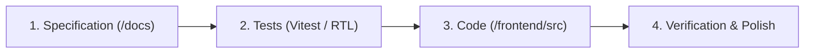

# AGENTS.md — OryxOps Contributor & AI Agent Guide

Welcome to **OryxOps**. This repository houses the front-facing flight operations web portal and Electronic Flight Bag (EFB) for **Qatar Airways Virtual (Qatari Virtual)** (`qatarivirtual.com`).

All AI coding assistants (Antigravity, Copilot, Claude, etc.) and human engineers contributing to this repository **must strictly adhere** to the principles, workflows, and standards documented below.

---

## 1. The Core Philosophy: Spec-Driven Development (SDD)

> **THE IRON LAW OF ORYXOPS:**
> **Documentation First $\rightarrow$ Tests Second $\rightarrow$ Implementation Third.**
> Never write UI component code or application logic without first having an approved specification in `/docs` and corresponding test coverage in `/frontend/src` or `/tests`.

Every component, design token update, or feature must progress through three discrete phases:

1. **Phase 1: Specification (`/docs/`)**:
   - Define component APIs, visual design tokens (light/dark Al-Annabi burgundy theme), props, accessibility requirements (ARIA), and edge cases.
   - Update the relevant document in `/docs/` (e.g. `design-system-spec.md`, `component-showcase-spec.md`).
2. **Phase 2: Tests (`/frontend/src/**/__tests__/`)**:
   - Write component unit/render tests using Vitest and React Testing Library asserting proper rendering, variant classes, keyboard accessibility, and state transitions.
   - Tests **must fail** initially (red) or prove the absence of the component.
3. **Phase 3: Implementation (`/frontend/src/`)**:
   - Implement the minimal, clean, accessible React component required to satisfy the specification and turn tests green.
   - Ensure full compatibility with Tailwind CSS v4, shadcn/ui primitives, and Kokonut UI micro-interactions.
4. **Phase 4: Verification & Component Showcase Sync**:
   - Verify the component on the interactive Component Showcase page (`/design-system`).
   - Run linters, TypeScript type checks (`tsc --noEmit`), and test suites (`pnpm test`).

---

## 2. Project Architecture & Stack

- **Framework / Runtime:** [React 19](https://react.dev/) + [Vite](https://vitejs.dev/) + [TypeScript 5+](https://www.typescriptlang.org/)
- **Styling Pipeline:** [Tailwind CSS v4](https://tailwindcss.com/) with `@tailwindcss/vite`
- **Component Primitives:** [shadcn/ui](https://ui.shadcn.com/) (Radix UI primitives / Tailwind-styled accessible tokens)
- **Micro-Interactions & Sleek UI:** [Kokonut UI](https://kokonutui.com/) (action lists, glow cards, shimmer inputs, bento grids)
- **Icons:** [`@remixicon/react`](https://remixicon.com/) (Remix Icon exclusively across all navigation, shadcn primitives, and EFB tools)
- **State Management:** `@reduxjs/toolkit` and `react-redux`
- **Routing:** `react-router-dom` (v7)
- **Testing:** Vitest, React Testing Library (`@testing-library/react`), `@testing-library/jest-dom`, `jsdom`
- **Upstream Telemetry Gateway:** OryxGate REST API (`/api/v1/fleet/*`, `/api/v1/flights/*`)

---

## 3. Brand Identity & Visual Guidelines

OryxOps reflects the luxury, precision, and distinction of **Qatar Airways Virtual** (`qatarivirtual.com`):
- **Primary Brand Color (Al-Annabi Burgundy):**
  - Light mode: Deep burgundy `#6A0C2C` / Dark accent `#4A0820` / Pale surface `#FDF8F9`
  - Dark mode: Regal burgundy `#A8244E` / Deep surface `#161920` / Canvas `#0D0E12`
- **Secondary Accents:** Warm champagne gold (`#C5A059` / `#D4AF37`) for executive alerts, pilot rankings, and flight highlights.
- **Surface Contrast:** High-contrast, clean cards with soft border lines (`#EAD9DF` light, `#272A35` dark) and subtle backdrop blurs (`backdrop-blur-md`). Heavy generic box shadows are discouraged.
- **Aviation Typography:** Tabular monospace (`font-mono`) for UTC timestamps, ICAO/IATA airport codes, flight callsigns, and altitudes.

---

## 4. Engineering & Contribution Rules

### A. Strict Scope Discipline
- For the initial phase, **do not implement backend or complex pilot operations logic** (e.g. actual automated unassignment cron jobs or raw Infinite Flight API polling).
- Backend abstraction belongs in **OryxGate**.
- Future pilot operations features (assignment, schedule booking, stopped aircraft guard, ACARS) are documented in `docs/pilot-operations-domain.md` for architectural context only.
- Focus strictly on building the design system, shadcn/kokonut UI component library, and the **Component Showcase Page**.

### B. Accessibility & Responsive Standards
- All shadcn and Kokonut UI components must support full keyboard navigation (`Tab`, `Space`, `Enter`, `Escape`, arrow keys).
- Contrast ratios must comply with WCAG AA standards against both light (`#FDF8F9`) and dark (`#0D0E12`) canvases.
- Breakpoints must behave smoothly across mobile (`375px+`), tablet (`768px+`), and widescreen operational monitors (`1440px+`).

### C. No Dead Code or Stray Styles
- Styles must route through CSS variables in `globals.css` / `style.css` rather than arbitrary one-off Tailwind hex values.
- Shared components reside in `frontend/src/components/ui/` or `frontend/src/components/kokonut/`.

---

## 5. Agent Instructions for Common Tasks

### Task 1: Adding a New shadcn or Kokonut Component
1. **Update Specs:** Check `docs/design-system-spec.md` or `docs/component-showcase-spec.md` for props, variants, and token mapping.
2. **Write Tests:** Add unit tests in `frontend/src/components/ui/__tests__/<Component>.test.tsx` asserting rendering, variants, and keyboard focus.
3. **Implement:** Scaffold the component under `frontend/src/components/ui/` or `frontend/src/components/kokonut/`, adhering to Qatar Al-Annabi CSS variables.
4. **Showcase:** Add a dedicated interactive sample block in the Component Showcase page (`frontend/src/pages/ComponentShowcase.tsx`).

### Task 2: Modifying Design Tokens or Theme
1. **Update Specs:** Update `docs/design-system-spec.md` with new CSS variable definitions.
2. **Implement:** Update `:root` and `.dark` variables in `frontend/src/style.css` (or `globals.css`).
3. **Verify:** Check both light and dark mode appearance in the Component Showcase.

---

## 6. Definition of Done (DoD)

A pull request or task is complete only when:
- [ ] Specification in `/docs/` is updated or created.
- [ ] Automated tests assert rendering, variants, and interactions.
- [ ] Component is showcased with interactive controls on `/design-system`.
- [ ] TypeScript compiles cleanly (`tsc --noEmit`).
- [ ] Both light mode and dark mode render flawlessly with Qatar Al-Annabi branding.
- [ ] No regression across existing application routes.
