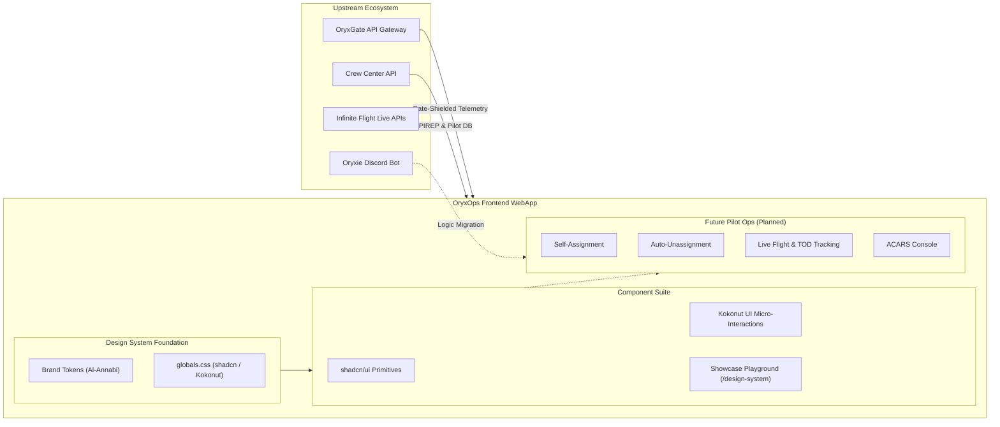

# OryxOps Documentation 📚✈️

Welcome to the central technical documentation and specification repository for **OryxOps**. 

OryxOps operates under **Spec-Driven Development (SDD)**. Every UI component, design token, user workflow, and architectural boundary is detailed here before code is written or tests are authored.

---

## 📑 Core Documentation Index

| Document | Description | Target Audience |
| :--- | :--- | :--- |
| [**AGENTS.md**](file:///c:/Users/bum90/Bumy/Coding/OryxOps/AGENTS.md) | Contributor and AI coding agent guidelines, The Iron Law of SDD, and constraints. | All contributors, AI Agents |
| [**Spec-Driven Development Guide**](file:///c:/Users/bum90/Bumy/Coding/OryxOps/docs/spec-driven-development.md) | Three-phase SDD workflow, test requirements, and Definition of Done. | All contributors |
| [**Design System Specification**](file:///c:/Users/bum90/Bumy/Coding/OryxOps/docs/design-system-spec.md) | Qatari Virtual brand tokens, Al-Annabi burgundy palette, shadcn/ui & Kokonut UI architecture. | UI/UX Engineers, Frontend Devs |
| [**Design Inspiration Reference**](file:///c:/Users/bum90/Bumy/Coding/OryxOps/docs/design-inspiration.md) | Visual reference screenshots and component blueprints from `qatarivirtual.com`. | UI/UX Engineers, Frontend Devs |
| [**Component Showcase Specification**](file:///c:/Users/bum90/Bumy/Coding/OryxOps/docs/component-showcase-spec.md) | Interactive living styleguide and proof-of-concept components for the upcoming MVP operations portal. | Frontend Devs, QA Engineers |
| [**Pilot Operations Domain & Migration**](file:///c:/Users/bum90/Bumy/Coding/OryxOps/docs/pilot-operations-domain.md) | IF Live limitations, future central pilot operations service, and Oryxie bot logic migration. | System Architects, Ops Staff |
| [**Implementation Roadmap**](file:///c:/Users/bum90/Bumy/Coding/OryxOps/docs/roadmap.md) | Phased delivery plan from design token setup to component showcase cutover. | Tech Leads, Contributors |
| [**Tasks & Sprints Execution Plan**](file:///c:/Users/bum90/Bumy/Coding/OryxOps/docs/tasks-and-sprints.md) | Granular, bite-sized tasks formatted ready for GitHub Issues. | Contributors, Project Managers |

---

## 🏛️ High-Level System Context

---

## 🚀 Getting Started with Development

1. Review [**AGENTS.md**](file:///c:/Users/bum90/Bumy/Coding/OryxOps/AGENTS.md) for contribution rules.
2. Review the [**Design System Specification**](file:///c:/Users/bum90/Bumy/Coding/OryxOps/docs/design-system-spec.md) to understand Qatar Airways Virtual visual tokens.
3. Review [**Tasks & Sprints**](file:///c:/Users/bum90/Bumy/Coding/OryxOps/docs/tasks-and-sprints.md) to pick up open tasks for sprint execution.
