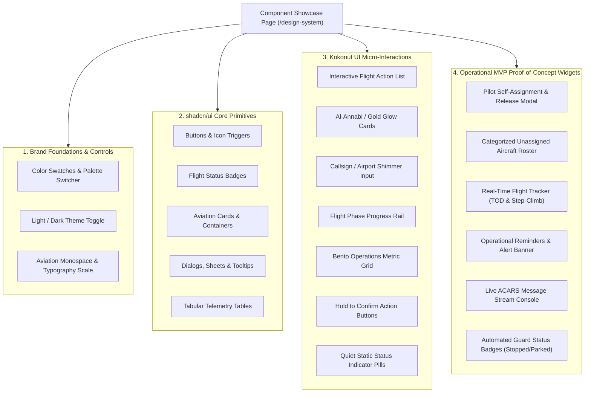

# Component Showcase Specification 🧪🖥️

> Living Interactive Styleguide, Component Stress-Test, and Proof-of-Concept Playground for the OryxOps Design System.

---

## 1. Overview & Purpose

The **Component Showcase Page** (`/design-system` or `frontend/src/pages/ComponentShowcase.tsx`) is an interactive living styleguide and component laboratory. Its primary objective is two-fold:
1. **Showcase Visual Primitives:** Display all **shadcn/ui** and **Kokonut UI** components styled with Qatari Virtual brand tokens in both Light Mode (`#FDF8F9`) and Dark Mode (`#0D0E12`).
2. **Prove MVP Feasibility:** Prove through realistic mock widgets that this component design system is expressive and complete enough to assemble the upcoming **MVP Operational Features** (addressing the critical gaps in Infinite Flight Live).

---

## 2. Page Architecture & Section Layout

The showcase page is structured into six comprehensive sections:



---

## 3. Detailed Showcase Sections

### Section 1: Brand Foundations & Theme Switcher
- **Interactive Theme Controls:** Light / Dark mode toggle switch.
- **Al-Annabi Color Swatches:** Visual swatches rendering `--brand`, `--brand-dark`, `--brand-light`, `--brand-pale`, `--brand-border`, `--brand-gold`, and background levels.
- **Aviation Typography Scale:**
  - Display Headers: `QATAR AIRWAYS VIRTUAL OPERATIONS`
  - Flight Numbers & Monospace: `QTR843 (DOH -> LHR) FL380 480kts 312° 14:32:00Z`
  - Micro-Labels: `ESTIMATED ELAPSED TIME: 06H 45M`

---

### Section 2: shadcn/ui Core Primitives Gallery
1. **Buttons:**
   - Variants: `default` (Burgundy), `secondary`, `outline`, `gold` (Champagne), `ghost`, `destructive`.
   - States: Normal, Hover, Active, Disabled, Loading (with spinning icon).
2. **Badges:**
   - Flight States: `AIRBORNE` (Emerald), `RADAR TRACKED` (Sky), `TOD REACHED` (Amber), `STOPPED` (Rose/Red), `PARKED` (Indigo), `UNASSIGNED` (Slate).
3. **Card Variations:**
   - Simple stat card, aircraft telemetry card, schedule summary card.
4. **Interactive Overlays:**
   - Triggerable `Dialog` (Self-Assignment confirmation).
   - Triggerable `Sheet` (Flight Dispatch Briefing slide-over).
   - `Tooltip` hover examples explaining aviation acronyms (`TOD`, `STEP`, `ACARS`).
5. **Dense Telemetry Table:**
   - Sample table displaying 5 mock Qatar Airways flights with columns: `Flight`, `Aircraft`, `Pilot`, `Route`, `Altitude`, `GS`, `Status`, `Actions`.

---

### Section 3: Kokonut UI Micro-Interactions
1. **Interactive Action List (`ActionList`):**
   - Renders a selectable list of available Boeing 777-300ER and Airbus A350-1000 airframes.
   - Shows active highlight bar, registration badge, and instant click selection.
2. **Glow Border Card (`GlowCard`):**
   - Animated Al-Annabi and champagne gold border glow.
   - Displays a high-priority advisory: `TOD ADVISORY: 18 NM to Top of Descent into OTHH`.
3. **Shimmer Search Input (`ShimmerInput`):**
   - Sleek search input with animated border shimmer.
   - Placeholder: `Search pilot, callsign, or airframe registration (e.g. A7-APC)...`
4. **Flight Phase Rail (`PhaseRail`):**
   - Step rail with active state at `CRUISE (STEP 2/3)`.
   - Shows completed checkmarks for `PREFLIGHT` and `CLIMB`, and upcoming steps `TOD` and `LANDED`.
5. **Operational Bento Grid (`BentoGrid`):**
   - 4-tile bento grid displaying:
     - `14 Active Flights` (with quiet emerald status dot)
     - `8 Unassigned Airframes` (categorized by type)
     - `1 Stopped Aircraft Guard Triggered` (quiet rose alert dot)
     - `124 PIREPs Logged Today`
6. **Hold to Confirm Button (`HoldToConfirmButton`):**
   - Interactive button requiring a deliberate 1.5s hold with smooth perimeter progress fill.
   - Example 1: `[ Hold to Release Airframe A7-APC ]` (turns burgundy fill).
   - Example 2: `[ Hold to Force Unassign ]` (destructive rose fill).
7. **Quiet Static Status Pill (`StatusPill`):**
   - High-contrast, zero-animation status indicator chips: `AIRBORNE` (emerald dot), `HOLDING` (amber dot), `STOPPED` (rose dot), `PARKED` (indigo dot). Quiet, clean, and completely static.

---

### Section 4: Operational MVP Proof-of-Concept Widgets

To prove the design system is completely ready to build the new OryxOps webapp MVP, the showcase includes functional mock widgets for each required capability:

#### Widget 1: Pilot Self-Assignment & Release Card
- **Problem Solved:** IF Live only allows admins to assign aircraft. Pilots cannot assign themselves or view assignments cleanly.
- **UI Solution:** A self-assignment card with pilot profile header, currently assigned aircraft (`A7-APC / A350-900`), booked schedule (`QR843 OTHH-EGLL`), and two primary actions: `[Book New Schedule]` (opens modal) and `[Release Airframe]` (with confirmation dialog).

#### Widget 2: Categorized Unassigned Aircraft Roster
- **Problem Solved:** IF Live cannot display airframes with no assigned pilot ahead in a categorized list.
- **UI Solution:** Filterable card list categorized by aircraft family:
  - Widebody (`A350-1000`, `A350-900`, `B777-300ER`, `B787-9`)
  - Narrowbody (`A320-200`, `A321neo`)
  - Cargo (`B777F`)
- Each item shows Registration, Current Location, Fuel Status, and a quick `[Claim Aircraft]` button.

#### Widget 3: Real-Time Flight Tracker (TOD & Step-Climb Indicator)
- **Problem Solved:** IF Live lacks real-time flight tracking with calculation of when to step climb and when TOD happens.
- **UI Solution:** Telemetry HUD widget featuring:
  - Progress bar along route `OTHH` $\rightarrow$ `EGLL`.
  - Current Altitude: `FL360` with indicator: `STEP CLIMB TO FL380 DUE IN 42 MIN`.
  - Distance to TOD: `124 NM (ETA: 15:42Z)`.
  - Ground Speed and Wind component vectors.

#### Widget 4: Automated Guards & Reminder Alert Banner
- **Problem Solved:** IF Live cannot send reminders or automate the release of stopped/parked aircraft.
- **UI Solution:**
  - Status alert showing: `Automated Guard: Aircraft A7-BAB has been airborne-stopped for 18 minutes. Escalation timer: 12 min remaining before automated unassignment.`
  - Button to `[Send Discord Pilot Reminder]` or `[Force Release Now]`.

#### Widget 5: Live ACARS Readout Console
- **Problem Solved:** IF Live provides zero ACARS stream or pilot event logs.
- **UI Solution:** Monospace black/slate terminal widget with real-time style log feed:
  ```text
  [14:10:02Z] ACARS: DEPARTURE OUT OF OTHH RWY 34R CONFIRMED
  [14:25:15Z] ACARS: PASSING FL180, ACCELERATING TO 320 KIAS
  [14:48:30Z] ACARS: CRUISE ALTITUDE FL360 REACHED, STEP ADVISORY CALCULATED
  [15:12:00Z] ACARS: SATCOM CONNECTION STABLE (VIA ORYXGATE)
  ```

---

## 4. Verification & Testing Strategy

1. **Visual Regression & Responsiveness:**
   - Verify layout on 375px (Mobile), 768px (Tablet), 1280px (Desktop), and 1920px (Ultra-wide).
   - Verify high contrast readability in both Light Mode (`#FDF8F9`) and Dark Mode (`#0D0E12`).
2. **Accessibility Assertions:**
   - Tab key must navigate through all interactive controls in logical reading order.
   - Modals trap focus and close on `Escape`.
3. **Automated Component Unit Tests:**
   - Each primitive showcased has corresponding tests in `frontend/src/components/ui/__tests__/` and `frontend/src/components/kokonut/__tests__/`.
