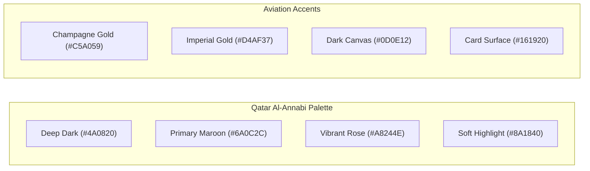
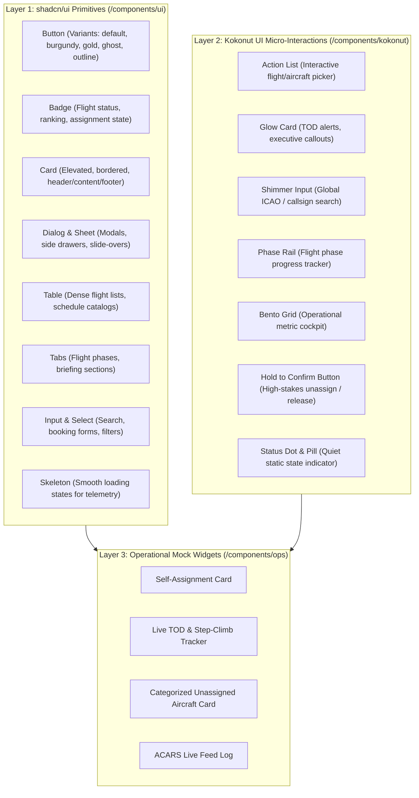

# Design System Specification 🎨✈️

> The Official Visual and Component Architecture for OryxOps, harmonized with the Qatar Airways Virtual (`qatarivirtual.com`) brand identity.

---

## 1. Design Direction & Brand Personality

OryxOps is an executive-tier aviation operations console. Its visual language merges the luxury and heritage of **Qatar Airways Virtual (Al-Annabi / Annabi Burgundy)** with the dense, real-time utility demanded by virtual airline dispatchers, flight operations officers, and airline captains.

### Core Visual Attributes
- **Heritage & Luxury:** Centered around the iconic Qatar Al-Annabi deep burgundy (`#6A0C2C` / `#A8244E`) complemented by subtle champagne gold highlights (`#C5A059`).
- **Operational Clarity:** High information density without visual clutter. Operational numbers (UTC, altitude, ground speed, coordinates, registrations) use tabular monospace typography.
- **Surface Elevation:** Crisp cards with hairline borders (`1px`) and soft glassmorphism (`backdrop-blur-md`), avoiding heavy, muddy shadows.
- **Sleek Micro-Interactions:** Powered by **Kokonut UI** for fluid state transitions, action pickers, pulsing telemetry indicators, and shimmer borders on active flight phases.
- **Visual Blueprints:** For live screenshot references of headers, metric counters, flight phase rails, accordions, and pilot cards, see [**Design Inspiration Reference**](file:///c:/Users/bum90/Bumy/Coding/OryxOps/docs/design-inspiration.md).

---

## 2. Color Palette & Semantic Tokens

The design system is powered by semantic CSS variables defined in `frontend/src/style.css` (or `globals.css`). Components use semantic CSS tokens rather than hardcoded hex colors, enabling automatic light and dark mode adaptation.

### 2.1 Brand Tokens (Al-Annabi & Champagne Gold)



| Token | Light Theme | Dark Theme | Role / Usage |
| :--- | :--- | :--- | :--- |
| `--brand` | `#6A0C2C` | `#A8244E` | Primary brand burgundy, selected states, CTA buttons |
| `--brand-dark` | `#4A0820` | `#6A0C2C` | Deep burgundy gradient stops, bold typography |
| `--brand-light` | `#8A1840` | `#C23867` | Hover backgrounds, secondary accents |
| `--brand-pale` | `#FDF8F9` | `#1A0E12` | Subtle brand-tinted surfaces & badge backgrounds |
| `--brand-border` | `#EAD9DF` | `#3F1E29` | Brand-tinted borders and dividers |
| `--brand-gold` | `#C5A059` | `#E5C378` | Champagne gold accent: VIP flights, TOD alerts, badges |
| `--brand-gold-glow` | `rgba(197, 160, 89, 0.15)` | `rgba(229, 195, 120, 0.25)` | Kokonut UI glow borders and focus rings |

---

### 2.2 Standard shadcn/ui Variable Mapping

To ensure seamless integration with the standard **shadcn/ui** component suite, the root tokens are mapped as follows:

```css
@layer base {
  :root {
    /* ── Light Mode (Clean Executive Portal) ──────────────── */
    --background: #fdf8f9;
    --foreground: #1f2937;
    --card: #ffffff;
    --card-foreground: #1f2937;
    --popover: #ffffff;
    --popover-foreground: #1f2937;
    --primary: #6A0C2C;               /* Al-Annabi Burgundy */
    --primary-foreground: #ffffff;
    --secondary: #f8fafc;
    --secondary-foreground: #334155;
    --muted: #f1f5f9;
    --muted-foreground: #64748b;
    --accent: #f8f1f4;
    --accent-foreground: #6A0C2C;
    --destructive: #be123c;
    --destructive-foreground: #ffffff;
    --border: #ead9df;
    --input: #ead9df;
    --ring: #6A0C2C;
    --radius: 0.75rem;

    /* Operational Table Header (qatarivirtual.com style) */
    --table-header-bg: #6A0C2C;
    --table-header-fg: #ffffff;

    /* Semantic Flight Status */
    --status-airborne: #10b981;
    --status-radar: #0284c7;
    --status-tod: #f59e0b;
    --status-stopped: #e11d48;
    --status-parked: #6366f1;
  }

  .dark {
    /* ── Dark Mode (Night Cockpit / Glass Aesthetic) ──────── */
    --background: #0d0e12;
    --foreground: #f3f4f6;
    --card: #161920;
    --card-foreground: #f3f4f6;
    --popover: #161920;
    --popover-foreground: #f3f4f6;
    --primary: #a8244e;               /* Regal Burgundy Highlight */
    --primary-foreground: #ffffff;
    --secondary: #1e2028;
    --secondary-foreground: #cbd5e1;
    --muted: #1e2028;
    --muted-foreground: #94a3b8;
    --accent: #2b141c;
    --accent-foreground: #f3f4f6;
    --destructive: #e11d48;
    --destructive-foreground: #ffffff;
    --border: #272a35;
    --input: #272a35;
    --ring: #a8244e;
    --radius: 0.75rem;

    /* Operational Table Header (Night Cockpit) */
    --table-header-bg: #4A0820;
    --table-header-fg: #ffffff;

    /* Semantic Flight Status (Night) */
    --status-airborne: #34d399;
    --status-radar: #38bdf8;
    --status-tod: #fbbf24;
    --status-stopped: #fb7185;
    --status-parked: #818cf8;
  }
}
```

---

### 2.3 Tailwind CSS v4 `@theme` Configuration

The semantic tokens are bound to Tailwind utility classes via `@theme static` in `frontend/src/style.css`:

```css
@theme static {
  /* Qatar Al-Annabi Brand Tokens */
  --color-brand: var(--brand);
  --color-brand-dark: var(--brand-dark);
  --color-brand-light: var(--brand-light);
  --color-brand-pale: var(--brand-pale);
  --color-brand-border: var(--brand-border);
  --color-brand-hover-bg: var(--brand-hover-bg);
  --color-brand-gold: var(--brand-gold);
  --color-brand-gold-glow: var(--brand-gold-glow);

  /* shadcn/ui Semantic Color Tokens */
  --color-background: var(--background);
  --color-foreground: var(--foreground);
  --color-card: var(--card);
  --color-card-foreground: var(--card-foreground);
  --color-popover: var(--popover);
  --color-popover-foreground: var(--popover-foreground);
  --color-primary: var(--primary);
  --color-primary-foreground: var(--primary-foreground);
  --color-secondary: var(--secondary);
  --color-secondary-foreground: var(--secondary-foreground);
  --color-muted: var(--muted);
  --color-muted-foreground: var(--muted-foreground);
  --color-accent: var(--accent);
  --color-accent-foreground: var(--accent-foreground);
  --color-destructive: var(--destructive);
  --color-destructive-foreground: var(--destructive-foreground);
  --color-border: var(--border);
  --color-input: var(--input);
  --color-ring: var(--ring);

  /* Flight Status Colors */
  --color-status-airborne: var(--status-airborne);
  --color-status-radar: var(--status-radar);
  --color-status-tod: var(--status-tod);
  --color-status-stopped: var(--status-stopped);
  --color-status-parked: var(--status-parked);

  /* Table Header */
  --color-table-header-bg: var(--table-header-bg);
  --color-table-header-fg: var(--table-header-fg);

  /* Radius Tokens */
  --radius-sm: calc(var(--radius) - 4px);
  --radius-md: calc(var(--radius) - 2px);
  --radius-lg: var(--radius);
  --radius-xl: calc(var(--radius) + 4px);
}
```

---

## 3. Typography & Monospace Rules

Aviation operations demand instant legibility and zero number jitter when values update in real time.

1. **Primary Sans:** System UI, `-apple-system`, BlinkMacSystemFont, `Inter`, `Segoe UI`, Roboto, sans-serif.
   - Clean, neutral, high x-height for readability.
2. **Tabular Monospace (`font-mono`):**
   - Mandatory for:
     - UTC timestamps (`14:25:00Z`).
     - Flight numbers & callsigns (`QTR843`, `QR001`).
     - ICAO/IATA codes (`OTHH/DOH`, `EGLL/LHR`).
     - Aircraft registrations (`A7-APC`).
     - Altitude, Ground Speed, Heading (`FL380`, `482 kts`, `312°`).
     - Coordinates (`25.2731° N, 51.6081° E`).
3. **Display Headings:** Tight tracking (`tracking-tight`), heavy weight (`font-extrabold` or `font-black`), branded with `--brand-dark` or gradient Al-Annabi clips.

---

## 3.1 Iconography Standard: Remix Icon (`@remixicon/react`)

To maintain complete visual harmony with the existing navigation, Electronic Flight Bag (EFB), and operational panels, OryxOps standardizes **exclusively on Remix Icon (`@remixicon/react`)**. Lucide is excluded to prevent mismatched stroke weights and duplicate bundles.

### Common Aviation Icon Mapping
- **Flight & Navigation:** `RiPlaneLine`, `RiPlaneFill`, `RiFlightTakeoffLine`, `RiFlightLandLine`, `RiCompass3Line`, `RiRadarLine`
- **Actions & Controls:** `RiSearchLine`, `RiArrowRightLine`, `RiCheckLine`, `RiCloseLine`, `RiTimeLine`, `RiAlertLine`
- **Aircraft & Fleet:** `RiLuggageCartLine`, `RiDashboardFill`, `RiSettings3Fill`, `RiUser3Fill`
- **Standard Sizing:** `size={16}` for dense table rows and badges, `size={20}` for buttons and navigation items, `size={24}` for modal/card headers.

---

## 4. Component Architecture: shadcn/ui + Kokonut UI

The component architecture is divided into two synergistic layers:



### 4.0 Core Utilities & Test Foundation

#### Class Name Merger (`frontend/src/lib/utils.ts`)
- **API:** `cn(...inputs: ClassValue[]): string`
- **Purpose:** Combines `clsx` and `tailwind-merge` (`twMerge`) to allow conditional styling without duplicate or conflicting Tailwind CSS classes (e.g. `cn("px-2", condition && "px-4", "text-white")` resolves cleanly to `"px-4 text-white"`).
- **Types:** `ClassValue` from `clsx`.

#### Test Environment Setup (`frontend/src/test/setup.ts` & `frontend/vite.config.ts`)
- **Framework:** Vitest with `jsdom` testing environment.
- **DOM Matchers:** `@testing-library/jest-dom/vitest` registered globally in `setup.ts`.
- **Path Aliasing:** `@/*` mapped to `frontend/src/*` in Vite and TypeScript configs.

### 4.1 shadcn/ui Core Primitives (`frontend/src/components/ui/`)

> **Iron Rule: Never Author shadcn Components from 0.**
> Always pull the official primitive from the shadcn registry via `npx shadcn@latest add <component>` (inside `frontend/`, configured via `frontend/components.json`) or copy from the official shadcn/ui repository, then apply the **3 Mandatory OryxOps Adaptations**:
> 1. **Remix Icon Only:** Swap any `lucide-react` icons to `@remixicon/react` (`RiCloseLine`, `RiCheckLine`, `RiArrowRightLine`).
> 2. **Tailwind CSS v4 & 60fps Animations:** Replace `tailwindcss-animate` classes with GPU-accelerated keyframe animations in `style.css` (`translate3d`, `opacity`, `cubic-bezier(0.16, 1, 0.3, 1)`).
> 3. **Al-Annabi Brand Tokens:** Map colors to Qatar Al-Annabi CSS variables (`--brand`, `--primary: #6A0C2C`, `--ring`, `--border: #ead9df`, `--card`) and use `rounded-xl` / `rounded-2xl` radii.

1. **Button (`button.tsx`):**
   - Variants: `default` (Burgundy), `secondary`, `outline`, `ghost`, `gold` (Champagne Accent), `destructive`.
   - Sizes: `sm` (compact ops table), `default`, `lg`, `icon`.
   - States: `loading` with spinning spinner, `disabled`.
2. **Badge (`badge.tsx`):**
   - Variants: `default`, `burgundy`, `gold`, `airborne` (emerald), `radar` (sky), `tod` (amber), `stopped` (rose), `parked` (indigo).
3. **Card (`card.tsx`):**
   - Standard container for telemetry panels and schedule cards. Hairline border, `rounded-xl`, subtle hover lift.
   - Variants: `default`, `accent-stripe` (signature 4px Al-Annabi vertical stripe for NOTAMs, dispatch advisories, and pilot quotes), and `fleet` (deep burgundy canvas with faded ICAO watermark).
4. **Vertical Timeline (`timeline.tsx`):**
   - Vertical operational timeline with continuous burgundy spine and circular state nodes for ACARS events and flight phase logs.
5. **Dialog & Sheet (`dialog.tsx`, `sheet.tsx`):**
   - Accessible modal dialog and sliding drawer overlays powered by `@radix-ui/react-dialog`.
   - **Dialog API:**
     - `Dialog` (Root state manager)
     - `DialogTrigger` (Trigger button or element)
     - `DialogPortal` (Portaled overlay mount)
     - `DialogClose` (Accessible close trigger)
     - `DialogOverlay` (Backdrop with `bg-black/60` and `backdrop-blur-xs`)
     - `DialogContent` (Centered elevated modal container with Al-Annabi border, smooth scale/fade animations, and Remix Icon `RiCloseLine` close button)
     - `DialogHeader`, `DialogFooter`, `DialogTitle`, `DialogDescription`
   - **Sheet API:**
     - `Sheet` (Root state manager)
     - `SheetTrigger`, `SheetPortal`, `SheetClose`, `SheetOverlay`
     - `SheetContent` with `side`: `"right" | "bottom" | "left" | "top"` (default: `"right"`).
       - `side="right"`: Slide-out drawer from right edge (`sm:max-w-md`), tailored for Flight Dispatch Briefing, route remarks, and operational NOTAMs.
       - `side="bottom"`: Slide-up bottom sheet (`max-h-[85vh]` with `rounded-t-2xl`), tailored for mobile aircraft inspection, quick telemetry checklist, and ramp status checks.
       - `side="left"` / `side="top"`: Standard directional drawer options.
     - `SheetHeader`, `SheetFooter`, `SheetTitle`, `SheetDescription`
   - **Accessibility & Focus Management:**
     - Focus trap: When opened, focus is automatically moved to within the dialog/sheet content and trapped.
     - Dismissal: Automatically dismisses on `Escape` keypress or backdrop overlay click.
     - ARIA roles: `role="dialog"`, `aria-modal="true"`, accessible title and description associations.
   - **Motion & Performance (60fps):**
     - GPU-accelerated transforms (`translate3d`, `scale3d`) and opacity transitions with cubic-bezier easing (`cubic-bezier(0.16, 1, 0.3, 1)`), guaranteeing buttery smooth 60fps performance on all viewports without layout thrashing.
5. **Table (`table.tsx`):**
   - High-density table support with monospace cell alignment for aviation data.
6. **Tabs (`tabs.tsx`):**
   - Horizontal phase switchers with smooth sliding indicator in Al-Annabi burgundy.
7. **Tooltip (`tooltip.tsx`):**
   - Micro-guidance for aviation acronyms (TOD, STEP, VNAV, ETE, ETA).

### 4.2 Kokonut UI Animated Components (`frontend/src/components/kokonut/`)

1. **Action List (`action-list.tsx`):**
   - Interactive list component with keyboard navigation, active highlight bar, and slot metadata. Ideal for selecting available aircraft or schedules.
2. **Glow Border Card (`glow-card.tsx`):**
   - Dynamic animated gradient border reflecting Al-Annabi burgundy and champagne gold. Used for high-priority alerts (e.g. TOD approaching, stopped flight escalation).
3. **Shimmer Input (`shimmer-input.tsx`):**
   - Search bar with a subtle animated light sweep along the border. Used for global flight and pilot lookup.
4. **Flight Phase Rail (`phase-rail.tsx`):**
   - Interactive horizontal progress rail visualizing flight phases:
     `Preflight` $\rightarrow$ `Taxi` $\rightarrow$ `Climb` $\rightarrow$ `Cruise` $\rightarrow$ `TOD / Descent` $\rightarrow$ `Approach` $\rightarrow$ `Landed`.
5. **Bento Grid (`bento-grid.tsx`):**
   - High-density responsive grid layout for key operations statistics (Active Flights, Unassigned Airframes, Fleet Stopped, ACARS messages).
6. **Hold to Confirm Button (`hold-to-confirm.tsx`):**
   - High-stakes operational action trigger requiring a 1.5s press-and-hold with smooth radial/border fill. Used for critical non-undoable actions (e.g. *Hold to Release Airframe*, *Hold to Force Unassign*) to eliminate noisy modal prompts.
7. **Quiet Status Dot & Pill (`status-pill.tsx`):**
   - Crisp, static semantic state chip (6px indicator dot + monospace status code) without flashing or keyframe animations, ensuring a calm, distraction-free cockpit environment.

---

## 5. Responsive Breakpoint Rules

| Viewport | Width | Layout Behavior |
| :--- | :--- | :--- |
| Mobile | `< 640px` | Single column stacked cards, bottom navigation or drawer sheet, hidden secondary micro-labels. |
| Tablet | `640px - 1024px` | 2-column bento grids, collapsed navigation rail, horizontally scrollable operational tables. |
| Desktop | `1024px - 1440px` | 3-column bento grids, full two-column layout (sidebar + workspace), full flight phase rails. |
| Widescreen | `> 1440px` | Multi-panel live operations view: dispatch board + live radar + ACARS stream side-by-side. |

---

## 6. Accessibility & Testing Standards

- **WCAG AA Compliance:** All text combinations must exceed 4.5:1 contrast against their card and background canvas.
- **Keyboard Navigation:** Full keyboard navigation (`Tab`, `Shift+Tab`, `Enter`, `Space`, `Escape`) supported across all interactive elements.
- **Automated Tests:** Tested via Vitest and `@testing-library/react`.
