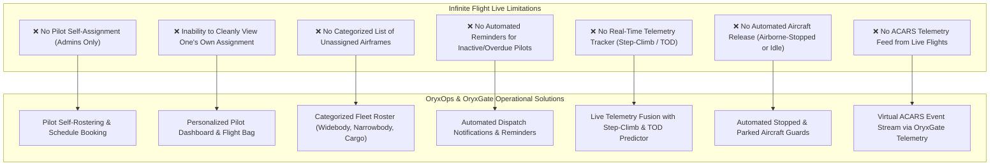
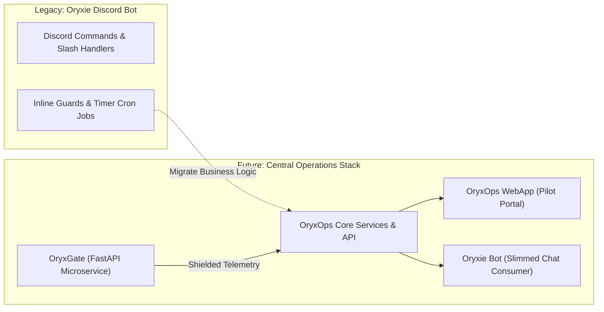
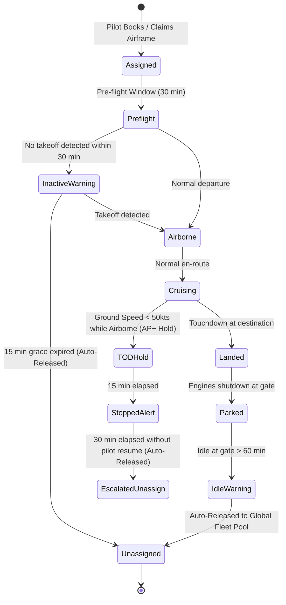

# Pilot Operations Domain & Migration Reference 🛫📋

> Comprehensive Reference of Infinite Flight Live Limitations, Automated Operations Guards, and Oryxie Discord Bot Migration into a Central Service.
>
> ⚠️ **NOTICE FOR CONTRIBUTORS & AI AGENTS:**
> This document details the long-term operational domain and upcoming backend/service migration. **Do NOT generate sprint tasks or implementation code for these backend operations in the current UI design system milestone.** This information is recorded here for architectural context and future planning.

---

## 1. The Operational Problem: Infinite Flight Live Gaps

Virtual Airline operations for Qatar Airways Virtual (`qatarivirtual.com`) operate on top of Infinite Flight's multiplayer infrastructure (Live v2 & v3). While Infinite Flight provides multiplayer positioning and raw fleet slots, it has severe operational limitations that make organized airline dispatch difficult:

### Detailed Breakdown of Deficiencies

1. **Self-Assignment Restriction:**
   In native Infinite Flight v3, only organization administrators can assign airframes to pilots. In a high-tempo virtual airline with hundreds of daily flights, this creates an unsustainable administrative bottleneck. Pilots must be able to self-assign authorized airframes based on their rank and booked schedules.
2. **Assignment Visibility:**
   Pilots cannot clearly inspect their currently claimed airframe, booked departure slot, route details, and equipment type in a consolidated view.
3. **Unassigned Aircraft Discovery:**
   Dispatchers and pilots cannot see which aircraft are currently free and available ahead in a categorized, filterable roster (e.g. categorized by A350, B777, A320, B787, Cargo).
4. **Dispatch Reminders:**
   No built-in capability to send pilots automated pre-flight reminders, slot expiration alerts, or descent check notifications.
5. **Real-Time Step-Climb & TOD Tracking:**
   Long-haul oceanic and continental flights require fuel-efficient step climbs (e.g. `FL340` $\rightarrow$ `FL360` $\rightarrow$ `FL380`) and accurate calculations for the Top of Descent (TOD) point. Infinite Flight does not calculate or display this to pilots or dispatchers in real time.
6. **Automated Aircraft Guards:**
   When a pilot lands, parks, or disconnects—or even worse, stops mid-air on Autopilot (AP+ hold at TOD)—the aircraft remains locked indefinitely in Infinite Flight v3 unless manually unassigned by staff.
7. **Virtual ACARS:**
   No event logging for flight milestones (out of gate, takeoff roll, cruise altitude reached, TOD advisory, touchdown, block in).

---

## 2. Core Capabilities to Migrate from Oryxie Bot

Many of these business rules and automation heuristics were prototyped inside the organization's Discord bot, **Oryxie**. 

As part of the modernization strategy, this operational logic will be transitioned from the Discord bot into a **central service / webapp operations stack** (with telemetry provided by **OryxGate**):

### The 9 Central Capabilities

| Capability | Current Oryxie Bot Behavior | Target Central Service Specification |
| :--- | :--- | :--- |
| **1. Assignment** | Discord slash command `/assign` claims airframe via direct MySQL update. | Central API endpoint validating pilot rank, type ratings, and locking airframe atomically. |
| **2. Unassignment** | Discord `/unassign` releases airframe back to VA pool. | Central API endpoint releasing airframe lock and updating IF v3 roster via OryxGate. |
| **3. Schedule Booking** | Bids on scheduled routes in MySQL table. | Clean REST schedule booking with auto-dispatch briefing generation. |
| **4. Available Aircraft** | Formats text embeds of available aircraft. | Categorized, filterable fleet catalog endpoint with real-time location and fuel state. |
| **5. Assigned Schedule** | Queries active schedule per pilot Discord ID. | Pilot portal view showing active schedule, OFP (Operational Flight Plan), and flight metrics. |
| **6. Tracking** | Queries live multiplayer positions and formats embed. | Live telemetry stream with Great Circle route projection, ground speed, and bearing. |
| **7. Stopped Aircraft Guard** | Background cron checks for stopped flights at TOD; sends Discord DM escalation warnings. | OryxGate telemetry fusion detects stopped airframe; OpsCore handles escalation timers and automated release. |
| **8. Fleet Logs** | Writes audit entries to Discord channels and database. | Structured event log and ACARS audit trail viewable in web console. |
| **9. Parked Aircraft Guard** | Detects aircraft parked at gate $> X$ hours and auto-releases them. | Central cron enforcing maximum ramp turnaround time and releasing idle aircraft to the roster. |

---

## 3. Automated Guard State Machine

The automated guard lifecycle ensures that no airframe remains locked when inactive:

---

## 4. Architectural Boundaries: OryxGate vs. OryxOps

To maintain clean separation of concerns and prevent code duplication:

1. **OryxGate Microservice (FastAPI Backend):**
   - Single source of truth for upstream Infinite Flight v2/v3, Crew Center, and MySQL connections.
   - Responsible for state fusion, Great Circle corridor calculations, Null Island filtering, and rate-limit shielding.
   - Exposes REST telemetry endpoints (`GET /api/v1/fleet/live`, `GET /api/v1/fleet/stopped`).
   - Pure, stateless observer boundary.
2. **OryxOps WebApp (React 19 Frontend):**
   - User-facing operations portal and EFB for pilots and staff.
   - Built on the Qatari Virtual Al-Annabi design system with shadcn/ui and Kokonut UI.
   - Provides intuitive UI for self-assignment, fleet inspection, live tracking, and reminder triggers.
   - Consumes OryxGate for high-performance telemetry ($< 5\text{ms}$ cached responses).

---

## 5. Next Steps for Planning

When the UI component design system and showcase page are fully established and verified, a formal specification phase for the **OryxOps Core Backend & Oryxie Migration** will be launched, referencing the domain requirements laid out in this document.
