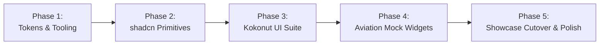

# OryxOps Design System Implementation Roadmap 🗺️🎨

> Phased delivery roadmap for transitioning OryxOps to the modernized shadcn/ui + Kokonut UI design system and establishing the interactive Component Showcase.

---

## Milestone Overview

---

## Phase 1: Design Tokens, Styling Pipeline, & Test Tooling
**Objective:** Establish the foundational CSS variables (Al-Annabi burgundy `#6A0C2C` & `#A8244E`, champagne gold `#C5A059`, dark slate `#161920`), configure Tailwind CSS v4, install shadcn/Kokonut dependencies, and set up Vitest component testing.

- [ ] Install required component packages (`clsx`, `tailwind-merge`, `@radix-ui/react-*`, `framer-motion` for Kokonut UI; standardize on existing `@remixicon/react`).
- [ ] Configure Vitest and React Testing Library (`vitest`, `@testing-library/react`, `@testing-library/jest-dom`, `jsdom`).
- [ ] Create `frontend/src/lib/utils.ts` with `cn()` utility function.
- [ ] Implement complete CSS semantic token definitions in `frontend/src/style.css` (or `globals.css`) supporting both Light Mode (`#FDF8F9`) and Dark Mode (`#0D0E12`).
- [ ] Author base token verification test (`frontend/src/lib/__tests__/utils.test.ts`).

---

## Phase 2: Core shadcn/ui Primitives Suite
**Objective:** Author unit-tested, accessible primitives customized with Qatari Virtual Al-Annabi branding and aviation monospace typography.

- [ ] Author tests and implement `Button` (`frontend/src/components/ui/button.tsx`) with variants: `default` (Burgundy), `secondary`, `outline`, `gold`, `destructive`, and `ghost`.
- [ ] Author tests and implement `Badge` (`frontend/src/components/ui/badge.tsx`) with aviation status variants (`airborne`, `radar`, `tod`, `stopped`, `parked`, `gold`).
- [ ] Author tests and implement `Card` (`frontend/src/components/ui/card.tsx`) with header, title, description, content, and footer primitives.
- [ ] Author tests and implement `Input` & `Textarea` with high-contrast borders and brand focus rings.
- [ ] Author tests and implement `Dialog` & `Sheet` for modals and sliding dispatch briefing drawers.
- [ ] Author tests and implement `Table` optimized for dense, monospace flight telemetry rows.
- [ ] Author tests and implement `Tabs` with animated burgundy sliding indicator.
- [ ] Author tests and implement `Tooltip` for quick guidance on aviation abbreviations.

---

## Phase 3: Kokonut UI Micro-Interactions & Animated Components
**Objective:** Implement sleek, high-impact interactive components using Kokonut UI patterns adapted for luxury airline operations.

- [ ] Author tests and implement `ActionList` (`frontend/src/components/kokonut/action-list.tsx`) for keyboard-navigable airframe and schedule selection.
- [ ] Author tests and implement `GlowCard` (`frontend/src/components/kokonut/glow-card.tsx`) featuring animated Al-Annabi and champagne gold ambient glow for TOD/escalation alerts.
- [ ] Author tests and implement `ShimmerInput` (`frontend/src/components/kokonut/shimmer-input.tsx`) with smooth light sweep animation for global search.
- [ ] Author tests and implement `PhaseRail` (`frontend/src/components/kokonut/phase-rail.tsx`) for visual step progression from Preflight to Landed.
- [ ] Author tests and implement `BentoGrid` (`frontend/src/components/kokonut/bento-grid.tsx`) for responsive operational dashboard metrics.
- [ ] Author tests and implement `HoldToConfirmButton` (`frontend/src/components/kokonut/hold-to-confirm.tsx`) for high-stakes operational actions (e.g. airframe release, force unassignment).
- [ ] Author tests and implement `StatusPill` & `StatusDot` (`frontend/src/components/ui/status-pill.tsx`) for quiet, static, zero-animation status indication.

---

## Phase 4: Aviation Domain Mock Widgets (MVP Proof-of-Concept)
**Objective:** Assemble the primitives into five realistic, domain-specific mock widgets that prove the design system fulfills the upcoming MVP operations requirements.

- [ ] Implement **Pilot Self-Assignment Card** (pilot profile, claimed airframe, booked schedule, book/release triggers).
- [ ] Implement **Categorized Unassigned Aircraft Roster** (categorized by Widebody, Narrowbody, Cargo with instant claim action).
- [ ] Implement **Live Flight & TOD Tracker HUD** (route progress, altitude, step-climb alert, distance/time to TOD).
- [ ] Implement **Automated Guard & Reminder Alert Banner** (stopped flight timer, escalation warnings, reminder buttons).
- [ ] Implement **Live ACARS Feed Console** (dark monospace console with timestamped flight milestones).

---

## Phase 5: Component Showcase Cutover & Verification
**Objective:** Mount the interactive Component Showcase page, wire routing, verify responsive behaviors, and validate zero regressions across light/dark themes.

- [ ] Implement `frontend/src/pages/ComponentShowcase.tsx` assembling all primitives, Kokonut UI components, and mock widgets with live interactive controls.
- [ ] Add `/design-system` route to `frontend/src/App.tsx` and a quick-navigation link in the top bar or development drawer.
- [ ] Author E2E/integration render test asserting all showcase sections mount cleanly without console warnings.
- [ ] Run full test suite (`pnpm test`), type check (`pnpm tsc --noEmit`), and linter.
- [ ] Verify visual fidelity against `qatarivirtual.com` design principles on mobile, tablet, and widescreen viewports.
