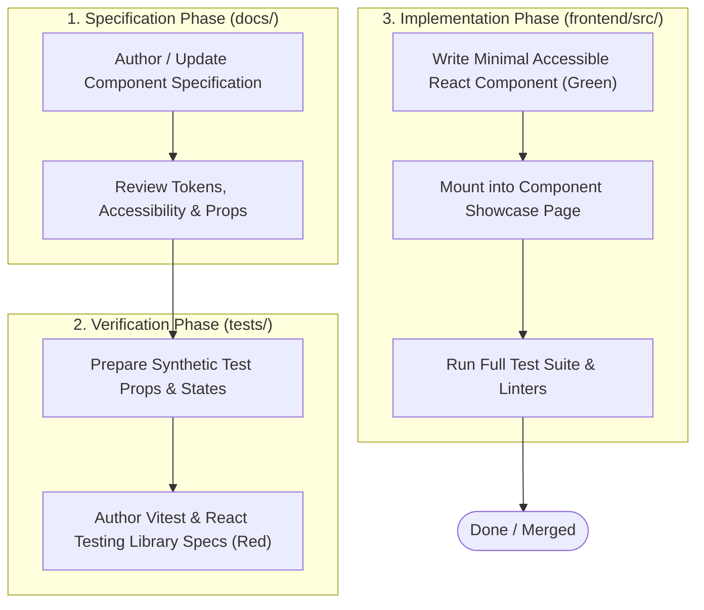

# Spec-Driven Development (SDD) Guide for OryxOps

## 1. What is Spec-Driven Development?

**Spec-Driven Development (SDD)** is an engineering discipline where **specifications and documentation act as the executable contract of intent**. In OryxOps, code is never written based on intuition or inline improvisation. Every component interface, visual token, layout contract, and interaction begins its life as written documentation.



---

## 2. Why SDD is Mandatory for OryxOps

1. **Brand Consistency with Qatari Virtual (`qatarivirtual.com`):**
   Qatari Virtual maintains a distinctive, luxury airline identity: **Al-Annabi burgundy**, champagne accents, dark glass, and high-contrast typography. Without specifications, component implementations drift into generic Tailwind shades or mismatched radii.
2. **Component Reusability across Multiple Operational Modules:**
   OryxOps powers high-density flight operations (Electronic Flight Bag, live radar, flight scheduling, pilot rosters, ACARS console). Components must be built as robust, composable primitives (shadcn/ui) with polished micro-interactions (Kokonut UI) rather than one-off page hacks.
3. **Seamless Hand-off Between Multiple Contributors:**
   Well-specified tasks allow human contributors and AI agents to work autonomously in parallel without stepping on tokens or reinventing buttons and modals.

---

## 3. The Three-Phase Workflow

### Phase 1: Specification (`/docs/`)
Before authoring any component in `frontend/src/`:
- **Define Purpose & Visual Role:** What role does the component fulfill?
- **Define Props & Typings:** TypeScript interfaces, optional attributes, and event handlers.
- **Define Style Tokens:** Exact CSS variables (`--brand`, `--card`, `--border`, `--primary`, `--ring`).
- **Define Accessibility & States:** Keyboard navigation, ARIA roles, disabled, loading, active, hover, and focus rings.

### Phase 2: Tests First (`frontend/src/**/__tests__/`)
Author unit tests using **Vitest** and **React Testing Library** asserting the exact contract:
- **Render Tests:** Assert that default and custom classes render as expected.
- **Variant Tests:** Verify that variant props (e.g. `variant="burgundy"`, `variant="outline"`, `variant="gold"`) apply correct CSS classes.
- **Interaction Tests:** Verify that `onClick`, `onValueChange`, and keyboard triggers fire appropriately.
- **Run the test suite:** Confirm that tests fail (red) or prove the component is missing before writing code.

### Phase 3: Implementation (`frontend/src/`)
Write the code to make the tests pass:
- **Never Build shadcn Primitives From Scratch:** Always scaffold/download the component directly from the official shadcn registry (`npx shadcn@latest add <component>` from `frontend/` or copy from the official shadcn/ui repository) and then adapt it.
- **Apply the 3 Mandatory Adaptations:**
  1. **Remix Icon Exclusive:** Replace `lucide-react` with `@remixicon/react` icons across triggers and close actions.
  2. **Tailwind CSS v4 & 60fps Motion:** Convert `tailwindcss-animate` classes to hardware-accelerated CSS keyframes in `style.css` (`translate3d`, `opacity`, `cubic-bezier(0.16, 1, 0.3, 1)`).
  3. **Qatar Al-Annabi Brand Tokens:** Map surfaces and borders to `--card`, `--border`, `--brand`, and `--ring` (`#6A0C2C` / `#a8244e`).
- Rely on semantic CSS variables defined in `style.css` (or `globals.css`).
- Add the component to the **Component Showcase Page** (`frontend/src/pages/ComponentShowcase.tsx`) with an interactive demonstration block.
- Verify that `npm test` passes and `npx tsc --noEmit` produces zero type errors.

---

## 4. Component Specification Template

When authoring a new component specification, use this template:

```markdown
# [COMP-XXX] Component Name

## 1. Overview
Description of the component, use cases, and whether it derives from shadcn/ui or Kokonut UI.

## 2. Component API (TypeScript)
\`\`\`typescript
export interface ComponentProps extends React.HTMLAttributes<HTMLDivElement> {
  variant?: "default" | "burgundy" | "outline" | "gold" | "destructive";
  size?: "sm" | "md" | "lg";
  isLoading?: boolean;
}
\`\`\`

## 3. Brand & CSS Variable Mapping
- Base Canvas: `var(--bg-card)`
- Border: `var(--border-main)`
- Primary Accent: `var(--brand)` (Al-Annabi burgundy)
- Focus Ring: `var(--ring)`

## 4. Accessibility & Keyboard Contract
- Role: `role="button"` or Radix primitive contract.
- Keyboard support: `Enter`, `Space`, `Escape`.
- High contrast focus rings.

## 5. Test Strategy
- Test 1: Renders default state without crashing.
- Test 2: Renders all visual variants (`burgundy`, `outline`, etc.).
- Test 3: Triggers interaction handlers on click or keypress.
- Test 4: Handles loading and disabled states cleanly.
```

---

## 5. Definition of Done Checklist

Every PR or task submitted to OryxOps must satisfy:
- [ ] Specification document in `/docs/` updated or created.
- [ ] Automated tests written in `frontend/src/**/__tests__/` covering variants and interactions.
- [ ] Implementation code written cleanly adhering to TypeScript standards.
- [ ] Component rendered and showcased in `/design-system` page.
- [ ] Full test suite green (`npm test`).
- [ ] Static type checks green (`npx tsc --noEmit`).
- [ ] Both light mode (`#FDF8F9`) and dark mode (`#0D0E12`) verified visually.
