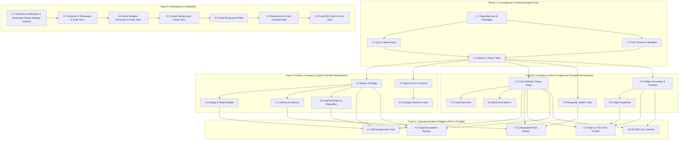

# OryxOps Tasks & Sprints Execution Plan 📋⚡

> Granular, bite-sized tasks and sprint backlog formatted specifically for direct copy-pasting into GitHub Issues.

---

## 1. Execution Philosophy

In accordance with **Spec-Driven Development (SDD)**:
- **No implementation code is written without prior tests.**
- Every task includes concrete **Dependencies**, **Files Affected**, and measurable **Acceptance Criteria (AC)**.
- Work is organized into 5 focused sprints progressing from styling foundations and primitive components to Kokonut UI animations, domain mock widgets, and the final interactive Component Showcase.

---

## 2. Parallel Dependency & Workstream Graph

The project is structured into **four concurrent workstreams** so multiple developers and AI agents can execute tasks in parallel without blocking each other once the foundation is established:

### ⚡ Parallel Execution Rules:
1. **Sprint 1 finishes first:** `1.1` $\rightarrow$ `1.2` & `1.3` concurrently $\rightarrow$ `1.4`.
2. **Track A & Track B run 100% in parallel:** While Dev 1 builds `Button` & `Badge` (`2.1`) and `Dialog` (`2.4`), Dev 2 can build `Card` (`2.2`) and `GlowCard` (`3.2`), and Dev 3 can build `Table & Tabs` (`2.5`) and `Accordion & Timeline` (`2.6`).
3. **Mock Widgets (Track C) unlock independently:** As soon as a widget's prerequisite components are green, that widget can be built immediately without waiting for the other four.
4. **Showcase Routing (`5.1`) can be scaffolded anytime:** Devs can mount their components into `/design-system` incrementally as each PR is merged.

---

## 3. Sprint Breakdown & GitHub Issue Tasks

---

### 🏃 Sprint 1: Design Tokens, Styling Pipeline, & Test Tooling
**Goal:** Establish the Al-Annabi burgundy design tokens, configure Tailwind CSS v4, install shadcn/Kokonut UI dependencies, and configure the automated Vitest test suite.

#### `TASK-1.1`: Package Installation & Component Dependencies
- **Description:** Install runtime and dev dependencies required for shadcn/ui and Kokonut UI: `clsx`, `tailwind-merge`, `@radix-ui/react-dialog`, `@radix-ui/react-tabs`, `@radix-ui/react-tooltip`, `@radix-ui/react-dropdown-menu`, `framer-motion`, plus testing tools `vitest`, `@testing-library/react`, `@testing-library/jest-dom`, `jsdom`. Standardize exclusively on the project's existing [`@remixicon/react`](https://remixicon.com/) icon system (already installed in `package.json`).
- **Dependencies:** None.
- **Files Affected:**
  - `frontend/package.json`
  - `frontend/package-lock.json`
- **Acceptance Criteria (AC):**
  - [ ] `npm install` completes with zero package peer conflicts.
  - [ ] `framer-motion`, `@radix-ui` primitives, and `@remixicon/react` icons import cleanly in TypeScript files.

#### `TASK-1.2`: Utility Helpers & Vitest Test Configuration
- **Description:** Implement `cn()` helper (`clsx` + `tailwind-merge`) in `frontend/src/lib/utils.ts`. Configure `vite.config.ts` to include Vitest with `jsdom` test environment and `@testing-library/jest-dom` matchers setup in `frontend/src/test/setup.ts`.
- **Dependencies:** `TASK-1.1`.
- **Files Affected:**
  - `frontend/src/lib/utils.ts`
  - `frontend/src/test/setup.ts`
  - `frontend/vite.config.ts`
  - `frontend/tsconfig.json`
- **Acceptance Criteria (AC):**
  - [x] `npm test` command executes Vitest successfully.
  - [x] `cn("px-2", condition && "px-4", "text-white")` resolves tailwind classes without duplicate conflicts.

#### `TASK-1.3`: Semantic CSS Variables & Theme Configuration
- **Description:** Update `frontend/src/style.css` with semantic CSS variables mapped to Qatar Airways Virtual brand identity (`qatarivirtual.com`):
  - Primary Brand (Al-Annabi Burgundy): Light `#6A0C2C`, Dark `#A8244E`
  - Deep Burgundy: Light `#4A0820`, Dark `#6A0C2C`
  - Champagne Gold Accent: Light `#C5A059`, Dark `#E5C378`
  - Flight Status Colors: Airborne (Emerald), Radar (Sky), TOD (Amber), Stopped (Rose/Red), Parked (Indigo).
  - Configure shadcn CSS variables (`--background`, `--foreground`, `--card`, `--primary`, `--border`, `--ring`).
- **Dependencies:** `TASK-1.1`.
- **Files Affected:**
  - `frontend/src/style.css`
- **Acceptance Criteria (AC):**
  - [x] `:root` and `.dark` variables provide full contrast compliance across both themes.
  - [x] Tailwind `@theme` directives expose `--color-brand`, `--color-brand-dark`, `--color-brand-gold`.

#### `TASK-1.4`: Theme & Token Unit Verification Test
- **Description:** Author unit tests asserting the `cn` utility and ensuring CSS variable classes evaluate without errors.
- **Dependencies:** `TASK-1.2`, `TASK-1.3`.
- **Files Affected:**
  - `frontend/src/lib/__tests__/utils.test.ts`
- **Acceptance Criteria (AC):**
  - [x] Automated tests pass with 100% assertions green via `npm test`.

#### `TASK-1.5`: GitHub Action Reviewer Fetches Linked Issue Description
- **Description:** Enhance the OpenCode agentic PR reviewer GitHub Actions workflow (`.github/workflows/opencode.yml`) to dynamically detect and fetch linked issue details (title and description) using the GitHub CLI (`gh`). Prioritizes branch prefix numbers (`<issue-number>-...`) generated when branches are created directly from GitHub issues, with a fallback to `(#<issue-number>)` tags in the PR title, passing the retrieved issue context directly into OpenCode for issue-informed code reviews.
- **Dependencies:** `TASK-1.1`.
- **Files Affected:**
  - `.github/workflows/opencode.yml`
  - `docs/tasks-and-sprints.md`
- **Acceptance Criteria (AC):**
  - [x] Workflow extracts leading numeric prefix from branch names (e.g. `21-task-12...` -> `21`).
  - [x] Fallback correctly parses `(#XX)` issue numbers from PR title.
  - [x] Fetches issue title and body via `gh issue view` and sets multiline `context` output.
  - [x] Passes retrieved issue context to `dceoy/opencode-action` prompt input for contextual code review.
  - [x] Step summary annotates the resolved issue number.

---

### 🏃 Sprint 2: Core shadcn/ui Primitives Suite
**Goal:** Build accessible, typed shadcn/ui primitives customized for aviation operational clarity and styled with Al-Annabi burgundy tokens.

#### `TASK-2.1`: Button & Badge Primitives
- **Description:** Implement `Button` (`frontend/src/components/ui/button.tsx`) and `Badge` (`frontend/src/components/ui/badge.tsx`) using `class-variance-authority`.
  - Button Variants: `default` (Al-Annabi burgundy), `secondary`, `outline`, `gold` (champagne), `ghost`, `destructive`. Sizes: `sm`, `default`, `lg`, `icon`. Support `loading` state with spinner.
  - Badge Variants: `default`, `burgundy`, `gold`, `airborne`, `radar`, `tod`, `stopped`, `parked`, `outline`.
- **Dependencies:** `TASK-1.3`.
- **Files Affected:**
  - `frontend/src/components/ui/button.tsx`
  - `frontend/src/components/ui/badge.tsx`
  - `frontend/src/components/ui/__tests__/button.test.tsx`
  - `frontend/src/components/ui/__tests__/badge.test.tsx`
  - `frontend/src/pages/ComponentShowcase.tsx`
- **Acceptance Criteria (AC):**
  - [ ] Unit tests verify all variants and disabled/loading states.
  - [ ] Keyboard focus ring renders with `--ring` (burgundy glow).
  - [ ] Interactive Button and Badge showcase previews added to Component Showcase (`/design-system`).

#### `TASK-2.2`: Card & Container Primitives (with Signature Accent Stripe)
- **Description:** Implement `Card`, `CardHeader`, `CardTitle`, `CardDescription`, `CardContent`, and `CardFooter` (`frontend/src/components/ui/card.tsx`).
  - Variants:
    - `default`: Clean hairline border (`--border`), subtle backdrop blur, and dark-mode elevation.
    - `accent-stripe`: Signature 4px vertical Al-Annabi burgundy stripe (`border-l-4 border-brand`) along the left edge for NOTAMs, dispatch advisories, and pilot quotes (as seen in `qatarivirtual.com`).
    - `fleet`: Deep burgundy canvas (`#4A0820`) with faded ICAO code watermark typography.
- **Dependencies:** `TASK-1.3`.
- **Files Affected:**
  - `frontend/src/components/ui/card.tsx`
  - `frontend/src/components/ui/__tests__/card.test.tsx`
  - `frontend/src/pages/ComponentShowcase.tsx`
- **Acceptance Criteria (AC):**
  - [x] Cards render cleanly on light (`#FDF8F9`) and dark (`#0D0E12`) canvases with correct hairline border (`--border`).
  - [x] `variant="accent-stripe"` renders the 4px left burgundy accent bar without layout shift.
  - [x] `variant="fleet"` renders deep burgundy surface with contrast-compliant text.
  - [ ] Interactive Card variants (default, accent-stripe, fleet) added to Component Showcase (`/design-system`).

#### `TASK-2.3`: Input, Textarea & Form Controls
- **Description:** Implement `Input` and `Textarea` primitives with tabular monospace font option for callsigns, ICAO codes, and flight levels.
- **Dependencies:** `TASK-1.3`.
- **Files Affected:**
  - `frontend/src/components/ui/input.tsx`
  - `frontend/src/components/ui/textarea.tsx`
  - `frontend/src/components/ui/__tests__/input.test.tsx`
  - `frontend/src/pages/ComponentShowcase.tsx`
- **Acceptance Criteria (AC):**
  - [ ] Inputs display focus ring in Al-Annabi burgundy without double border clipping.
  - [ ] Interactive Input and Textarea controls added to Component Showcase (`/design-system`).

#### `TASK-2.4`: Dialog & Sheet Overlays
- **Description:** Implement accessible `Dialog` (modal) and `Sheet` (slide-out drawer) using `@radix-ui/react-dialog`. Sheet supports slide directions: `right` (for dispatch briefing) and `bottom` (for mobile inspection).
- **Dependencies:** `TASK-2.1`.
- **Files Affected:**
  - `frontend/src/components/ui/dialog.tsx`
  - `frontend/src/components/ui/sheet.tsx`
  - `frontend/src/components/ui/__tests__/dialog.test.tsx`
  - `frontend/src/pages/ComponentShowcase.tsx`
- **Acceptance Criteria (AC):**
  - [x] Dialog traps focus properly and dismisses on `Escape` or backdrop click.
  - [x] Slide-out animation performs smoothly at 60fps.
  - [ ] Interactive Dialog and Sheet trigger previews added to Component Showcase (`/design-system`).

#### `TASK-2.5`: High-Density Aviation Table & Tabs
- **Description:** Implement `Table` (`frontend/src/components/ui/table.tsx`) optimized for tabular monospace operational figures.
  - Table Features: Supports solid Al-Annabi burgundy header variant (`--table-header-bg: #6A0C2C` with bold white text) as used in the `qatarivirtual.com` Route Database, callsign outline badges, and right-aligned monospace duration cells.
  - Tabs: Implement `Tabs`, `TabsList`, `TabsTrigger`, and `TabsContent` (`frontend/src/components/ui/tabs.tsx`) with Al-Annabi burgundy active pill.
- **Dependencies:** `TASK-1.3`.
- **Files Affected:**
  - `frontend/src/components/ui/table.tsx`
  - `frontend/src/components/ui/tabs.tsx`
  - `frontend/src/components/ui/__tests__/table.test.tsx`
  - `frontend/src/pages/ComponentShowcase.tsx`
- **Acceptance Criteria (AC):**
  - [ ] Table headers support solid burgundy background variant and standard transparent variant.
  - [ ] Table cells support compact vertical padding and tabular monospace alignment.
  - [ ] Tabs switch active content smoothly via keyboard arrow keys.
  - [ ] Interactive Table and Tabs previews added to Component Showcase (`/design-system`).

#### `TASK-2.6`: Tooltip, Skeleton, Accordion & Vertical Timeline
- **Description:** Implement auxiliary primitives:
  - `Tooltip` (`frontend/src/components/ui/tooltip.tsx`): for clarifying operational abbreviations (TOD, STEP, VNAV, ACARS).
  - `Skeleton` (`frontend/src/components/ui/skeleton.tsx`): for smooth telemetry loading placeholders.
  - `Progress` (`frontend/src/components/ui/progress.tsx`): for route completion and fuel status.
  - `Accordion` (`frontend/src/components/ui/accordion.tsx`): separated card accordion based on `qatarivirtual.com` FAQ layout for flight briefing remarks and aircraft specs.
  - `VerticalTimeline` (`frontend/src/components/ui/timeline.tsx`): vertical operational event rail with continuous burgundy spine and state nodes for ACARS events.
- **Dependencies:** `TASK-1.3`.
- **Files Affected:**
  - `frontend/src/components/ui/tooltip.tsx`
  - `frontend/src/components/ui/skeleton.tsx`
  - `frontend/src/components/ui/progress.tsx`
  - `frontend/src/components/ui/accordion.tsx`
  - `frontend/src/components/ui/timeline.tsx`
  - `frontend/src/components/ui/__tests__/primitives.test.tsx`
  - `frontend/src/pages/ComponentShowcase.tsx`
- **Acceptance Criteria (AC):**
  - [ ] Tooltip appears on hover/focus after short 200ms delay.
  - [ ] Skeleton renders subtle pulse animation on dark/light surfaces.
  - [ ] Accordion items expand smoothly with 180° chevron rotation.
  - [ ] Vertical timeline connects chronological event cards along continuous burgundy spine.
  - [ ] Interactive Tooltip, Skeleton, Progress, Accordion, and Timeline previews added to Component Showcase (`/design-system`).

#### `TASK-2.7`: Sprint 2 Primitives Test Suite Verification & Showcase Integration
- **Description:** 
  1. Create route `/design-system` in `frontend/src/App.tsx` mapped to `ComponentShowcase` page (aliasing `/showcase` for backward compatibility). Add quick-access navigation trigger in top bar for developers (`frontend/src/components/layout/Layout.tsx`).
  2. Integrate all Sprint 2 shadcn primitives into the interactive showcase page (`frontend/src/pages/ComponentShowcase.tsx`), providing live interactive previews for Button, Badge, Card, Input, Textarea, Dialog, Sheet, Table, Tabs, Tooltip, Skeleton, Progress, Accordion, and Vertical Timeline.
  3. Run full Vitest test suite for all Sprint 2 primitives asserting 100% green tests and zero TypeScript errors.
- **Dependencies:** `TASK-1.1`, `TASK-2.1` through `TASK-2.6`.
- **Files Affected:**
  - `frontend/src/App.tsx`
  - `frontend/src/components/layout/Layout.tsx`
  - `frontend/src/pages/ComponentShowcase.tsx`
  - `frontend/src/components/ui/__tests__/*`
- **Acceptance Criteria (AC):**
  - [ ] Navigating to `/design-system` renders the showcase page.
  - [ ] Quick-access developer navigation trigger in top bar routes to `/design-system`.
  - [ ] Showcase renders interactive preview blocks for all Sprint 2 shadcn primitives (Buttons, Badges, Cards, Inputs, Textareas, Dialogs, Sheets, Tables, Tabs, Tooltips, Skeletons, Progress, Accordions, Timeline) with light and dark mode support.
  - [ ] All primitive tests pass cleanly (`npm test`).
  - [ ] Zero TypeScript errors (`npx tsc --noEmit`).

---

### 🏃 Sprint 3: Kokonut UI Micro-Interactions & Animated Components
**Goal:** Implement sleek, high-impact interactive components using Kokonut UI patterns adapted for luxury airline operations.

#### `TASK-3.1`: Interactive Action List (`ActionList`)
- **Description:** Implement `ActionList` component using `framer-motion` for selecting available aircraft or schedules. Supports keyboard navigation (`ArrowUp`, `ArrowDown`, `Enter`), active sliding indicator, and badge slots.
- **Dependencies:** `TASK-2.1`.
- **Files Affected:**
  - `frontend/src/components/kokonut/action-list.tsx`
  - `frontend/src/components/kokonut/__tests__/action-list.test.tsx`
  - `frontend/src/pages/ComponentShowcase.tsx`
- **Acceptance Criteria (AC):**
  - [ ] Items highlight smoothly with Al-Annabi burgundy active indicator.
  - [ ] Keyboard selection triggers `onSelect` callback.
  - [ ] Interactive ActionList preview added to Kokonut UI section in Component Showcase (`/design-system`).

#### `TASK-3.2`: Al-Annabi & Gold Glow Card (`GlowCard`)
- **Description:** Implement `GlowCard` with animated border gradient cycling subtly through Al-Annabi burgundy (`#6A0C2C`) and champagne gold (`#C5A059`). Used for high-priority operational callouts (TOD approaching, stopped flight escalation).
- **Dependencies:** `TASK-2.2`.
- **Files Affected:**
  - `frontend/src/components/kokonut/glow-card.tsx`
  - `frontend/src/components/kokonut/__tests__/glow-card.test.tsx`
  - `frontend/src/pages/ComponentShowcase.tsx`
- **Acceptance Criteria (AC):**
  - [ ] Border glow animation runs smoothly via CSS hardware-accelerated transforms without CPU spikes.
  - [ ] Interactive GlowCard preview added to Kokonut UI section in Component Showcase (`/design-system`).

#### `TASK-3.3`: Callsign & Airport Shimmer Search Input (`ShimmerInput`)
- **Description:** Implement `ShimmerInput` with animated light sweep along the border and inline search icon. Optimized for quick pilot, callsign, and ICAO lookups.
- **Dependencies:** `TASK-2.3`.
- **Files Affected:**
  - `frontend/src/components/kokonut/shimmer-input.tsx`
  - `frontend/src/components/kokonut/__tests__/shimmer-input.test.tsx`
  - `frontend/src/pages/ComponentShowcase.tsx`
- **Acceptance Criteria (AC):**
  - [ ] Shimmer light sweep activates on focus and input.
  - [ ] Clean clear button `[x]` resets input.
  - [ ] Interactive ShimmerInput preview added to Kokonut UI section in Component Showcase (`/design-system`).

#### `TASK-3.4`: Flight Phase Progress Rail (`PhaseRail`)
- **Description:** Implement `PhaseRail` visualizing the 7 flight phases:
  `Preflight` $\rightarrow$ `Taxi` $\rightarrow$ `Climb` $\rightarrow$ `Cruise` $\rightarrow$ `TOD / Descent` $\rightarrow$ `Approach` $\rightarrow$ `Landed`.
  Renders completed phases in emerald, current active phase in pulsing burgundy/gold, and upcoming phases in muted slate.
- **Dependencies:** `TASK-2.6`.
- **Files Affected:**
  - `frontend/src/components/kokonut/phase-rail.tsx`
  - `frontend/src/components/kokonut/__tests__/phase-rail.test.tsx`
  - `frontend/src/pages/ComponentShowcase.tsx`
- **Acceptance Criteria (AC):**
  - [ ] Transitions between phases smoothly with animated connector lines.
  - [ ] Responsive: scrolls horizontally on mobile without breaking layout.
  - [ ] Interactive PhaseRail preview added to Kokonut UI section in Component Showcase (`/design-system`).

#### `TASK-3.5`: Operational Bento Grid (`BentoGrid`)
- **Description:** Implement `BentoGrid` and `BentoCard` layout components for dashboard metrics (Active Flights, Unassigned Fleet, TOD Alerts, ACARS count). Supports span configurations (`col-span-1`, `col-span-2`, `row-span-2`).
- **Dependencies:** `TASK-2.2`.
- **Files Affected:**
  - `frontend/src/components/kokonut/bento-grid.tsx`
  - `frontend/src/components/kokonut/__tests__/bento-grid.test.tsx`
  - `frontend/src/pages/ComponentShowcase.tsx`
- **Acceptance Criteria (AC):**
  - [ ] Responsive grid adapts seamlessly from 1 column on mobile to 3-4 columns on desktop.
  - [ ] Interactive BentoGrid preview added to Kokonut UI section in Component Showcase (`/design-system`).

#### `TASK-3.6`: High-Stakes Action & Quiet State Indicators (`HoldToConfirmButton` & `StatusDot`)
- **Description:** Implement two minimal, zero-clutter components:
  1. `HoldToConfirmButton` (`frontend/src/components/kokonut/hold-to-confirm.tsx`): Sleek button requiring a smooth 1.5s press-and-hold with visual border progress fill before executing sensitive flight operations (e.g. "Hold to Release Airframe", "Hold to Force Unassign", "Hold to Cancel Flight"). Prevents accidental actions without disruptive popup modals.
  2. `StatusDot` / `StatusPill` (`frontend/src/components/ui/status-pill.tsx`): Completely static, quiet, high-contrast indicators (solid 6px indicator dot + clean tabular uppercase code) with semantic status styling (Airborne, Radar, TOD Advisory, Stopped, Parked). Zero continuous pulsing or CPU-taxing animation.
- **Dependencies:** `TASK-2.1`.
- **Files Affected:**
  - `frontend/src/components/kokonut/hold-to-confirm.tsx`
  - `frontend/src/components/ui/status-pill.tsx`
  - `frontend/src/components/kokonut/__tests__/hold-to-confirm.test.tsx`
  - `frontend/src/components/ui/__tests__/status-pill.test.tsx`
  - `frontend/src/pages/ComponentShowcase.tsx`
- **Acceptance Criteria (AC):**
  - [ ] `HoldToConfirmButton` triggers callback only after hold threshold (1500ms) and resets if released early.
  - [ ] `StatusDot` / `StatusPill` renders completely static without distracting CSS keyframe animations.
  - [ ] Supports dark (`#0D0E12`) and light (`#FDF8F9`) contrast standards with semantic colors.
  - [ ] Interactive HoldToConfirmButton and StatusDot previews added to Component Showcase (`/design-system`).

#### `TASK-3.7`: Kokonut UI Test Suite Verification & Showcase Sync
- **Description:** Run Vitest assertions covering all Kokonut UI components and verify interactive showcase integration on `/design-system`.
- **Dependencies:** `TASK-3.1` through `TASK-3.6`.
- **Files Affected:**
  - `frontend/src/components/kokonut/__tests__/*`
  - `frontend/src/pages/ComponentShowcase.tsx`
- **Acceptance Criteria (AC):**
  - [ ] All tests pass cleanly (`npm test`).
  - [ ] All Kokonut UI micro-interaction components are verified and operational on `/design-system`.

---

### 🏃 Sprint 4: Aviation Domain Mock Widgets (MVP Proof-of-Concept)
**Goal:** Assemble the primitives into five realistic, domain-specific mock widgets that prove the design system fulfills the upcoming MVP operations requirements.

#### `TASK-4.1`: Pilot Self-Assignment & Release Card Widget
- **Description:** Implement mock widget addressing the IF Live self-assignment gap. Displays pilot profile, currently assigned airframe (`A7-APC / A350-900`), booked schedule (`QR843 OTHH-EGLL`), and action buttons: `[Book Schedule]` (opens modal) and `[Release Aircraft]`.
- **Dependencies:** `TASK-2.1`, `TASK-2.2`, `TASK-2.4`.
- **Files Affected:**
  - `frontend/src/components/ops/SelfAssignmentCard.tsx`
  - `frontend/src/components/ops/__tests__/SelfAssignmentCard.test.tsx`
  - `frontend/src/pages/ComponentShowcase.tsx`
- **Acceptance Criteria (AC):**
  - [ ] Renders claimed aircraft metadata and triggers release confirmation dialog.
  - [ ] Interactive SelfAssignmentCard mounted in Operational MVP section on Component Showcase (`/design-system`).

#### `TASK-4.2`: Categorized Unassigned Aircraft Roster Widget
- **Description:** Implement widget displaying aircraft with no assigned pilot, categorized by family: Widebody (`A350-1000`, `B777-300ER`), Narrowbody (`A321neo`), Cargo (`B777F`). Each airframe shows registration, current location (`OTHH`), fuel status, and a `[Claim Airframe]` action button.
- **Dependencies:** `TASK-2.2`, `TASK-2.5`, `TASK-3.1`.
- **Files Affected:**
  - `frontend/src/components/ops/UnassignedAircraftList.tsx`
  - `frontend/src/components/ops/__tests__/UnassignedAircraftList.test.tsx`
  - `frontend/src/pages/ComponentShowcase.tsx`
- **Acceptance Criteria (AC):**
  - [ ] Category tabs filter airframes cleanly.
  - [ ] Claim button triggers instant action callback with registration payload.
  - [ ] Interactive UnassignedAircraftList mounted in Operational MVP section on Component Showcase (`/design-system`).

#### `TASK-4.3`: Real-Time Flight & TOD Tracker HUD Widget
- **Description:** Implement real-time flight telemetry widget displaying route progress `OTHH` $\rightarrow$ `EGLL`, current altitude (`FL360`), step climb advisory (`STEP CLIMB TO FL380 DUE IN 42 MIN`), distance to TOD (`124 NM`), and ground speed.
- **Dependencies:** `TASK-2.6`, `TASK-3.2`, `TASK-3.4`.
- **Files Affected:**
  - `frontend/src/components/ops/FlightTrackerHUD.tsx`
  - `frontend/src/components/ops/__tests__/FlightTrackerHUD.test.tsx`
  - `frontend/src/pages/ComponentShowcase.tsx`
- **Acceptance Criteria (AC):**
  - [ ] Displays route progress bar, step climb indicator, and TOD countdown banner in monospace tabular formatting.
  - [ ] Interactive FlightTrackerHUD mounted in Operational MVP section on Component Showcase (`/design-system`).

#### `TASK-4.4`: Automated Guards & Reminder Alert Banner Widget
- **Description:** Implement operational guard widget displaying stopped flight escalation alerts: `Aircraft A7-BAB has been airborne-stopped for 18 minutes. Escalation timer: 12 min before automated unassignment.` Includes actions `[Send Pilot Discord Reminder]` and `[Force Release Now]`.
- **Dependencies:** `TASK-2.1`, `TASK-2.2`, `TASK-3.6`.
- **Files Affected:**
  - `frontend/src/components/ops/OperationalGuardBanner.tsx`
  - `frontend/src/components/ops/__tests__/OperationalGuardBanner.test.tsx`
  - `frontend/src/pages/ComponentShowcase.tsx`
- **Acceptance Criteria (AC):**
  - [ ] Shows countdown timer, warning badge, and reminder dispatch trigger.
  - [ ] Interactive OperationalGuardBanner mounted in Operational MVP section on Component Showcase (`/design-system`).

#### `TASK-4.5`: Live ACARS Console Widget
- **Description:** Implement dark monospace console widget streaming simulated live ACARS flight events (Departure out of OTHH RWY 34R, passing FL180, cruise FL360 reached, TOD advisory calculated).
- **Dependencies:** `TASK-2.2`, `TASK-2.6`.
- **Files Affected:**
  - `frontend/src/components/ops/ACARSConsole.tsx`
  - `frontend/src/components/ops/__tests__/ACARSConsole.test.tsx`
  - `frontend/src/pages/ComponentShowcase.tsx`
- **Acceptance Criteria (AC):**
  - [ ] Monospace black/slate container with live timestamped event entries.
  - [ ] Interactive ACARSConsole mounted in Operational MVP section on Component Showcase (`/design-system`).

#### `TASK-4.6`: Mock Widgets Test Suite Verification & Showcase Sync
- **Description:** Run Vitest assertions covering all Sprint 4 operational mock widgets and verify all 5 proof-of-concept widgets mount in `/design-system`.
- **Dependencies:** `TASK-4.1` through `TASK-4.5`.
- **Files Affected:**
  - `frontend/src/components/ops/__tests__/*`
  - `frontend/src/pages/ComponentShowcase.tsx`
- **Acceptance Criteria (AC):**
  - [ ] All widget tests pass cleanly with zero errors (`npm test`).
  - [ ] All 5 operational MVP mock widgets mount interactively in `/design-system`.

---

### 🏃 Sprint 5: Integrated Component Showcase Page & Final Cutover
**Goal:** Assemble the comprehensive Component Showcase page, wire routing, verify responsive behaviors, and validate zero regressions across light/dark themes.

#### `TASK-5.1`: Component Showcase Navigation Hardening & E2E Route Verification
- **Description:** Audit and harden the `/design-system` route initialized in `TASK-2.7`. Ensure active state indicators in navigation bars, desktop & mobile drawer triggers (`frontend/src/components/layout/Layout.tsx`), anchor deep linking, and zero regression across standard routes.
- **Dependencies:** `TASK-2.7`, `TASK-4.6`.
- **Files Affected:**
  - `frontend/src/App.tsx`
  - `frontend/src/components/layout/Layout.tsx`
- **Acceptance Criteria (AC):**
  - [ ] Navigating to `/design-system` renders correctly across desktop and mobile viewports.
  - [ ] Navigation triggers display active state when on `/design-system`.
  - [ ] Zero regression on core application routes (`/`, `/efb`, `/operations`, etc.).

#### `TASK-5.2`: Interactive Showcase Playground Final Polish & Assembly
- **Description:** Final polish of `frontend/src/pages/ComponentShowcase.tsx` combining:
  1. Theme toggle & brand color swatches (Al-Annabi burgundy & gold).
  2. shadcn/ui primitives gallery (Buttons, Badges, Cards, Inputs, Textareas, Dialogs, Sheets, Tables, Tabs, Tooltips, Skeletons, Progress, Accordions, Timeline).
  3. Kokonut UI micro-interactions gallery (Action List, Glow Card, Shimmer Input, Phase Rail, Bento Grid, Hold to Confirm, Status Indicators).
  4. Operational MVP proof-of-concept widgets (Self-Assignment, Unassigned Fleet, Live TOD Tracker, Automated Guard Alert, ACARS Console).
- **Dependencies:** `TASK-4.6`, `TASK-5.1`.
- **Files Affected:**
  - `frontend/src/pages/ComponentShowcase.tsx`
- **Acceptance Criteria (AC):**
  - [ ] Page renders all sections cleanly with interactive controls and smooth transitions.

#### `TASK-5.3`: Responsive Layout & Dark Mode Audit
- **Description:** Audit the showcase page across 375px (mobile), 768px (tablet), 1280px (desktop), and 1920px (widescreen). Verify high contrast readability in both light (`#FDF8F9`) and dark (`#0D0E12`) modes.
- **Dependencies:** `TASK-5.2`.
- **Files Affected:**
  - `frontend/src/pages/ComponentShowcase.tsx`
  - `frontend/src/style.css`
- **Acceptance Criteria (AC):**
  - [ ] No layout overflow or clipped cards at any breakpoint.
  - [ ] Theme switch transitions smoothly without color flash.

#### `TASK-5.4`: Final E2E Test Suite & Documentation Sync
- **Description:** Run full test suite (`npm test`), run type checking (`npx tsc --noEmit`), and confirm documentation is in complete sync.
- **Dependencies:** `TASK-5.3`.
- **Files Affected:**
  - `docs/*`
  - `AGENTS.md`
- **Acceptance Criteria (AC):**
  - [ ] 100% test pass rate across all unit and component tests.
  - [ ] Zero TypeScript errors.
  - [ ] Showcase page ready for stakeholders to review and pick up GitHub issues.
